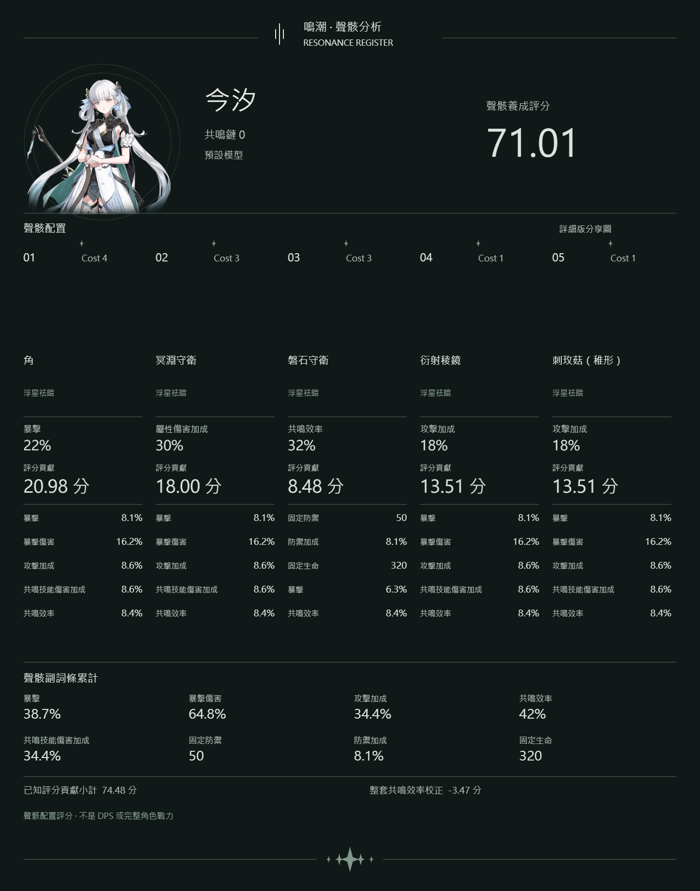
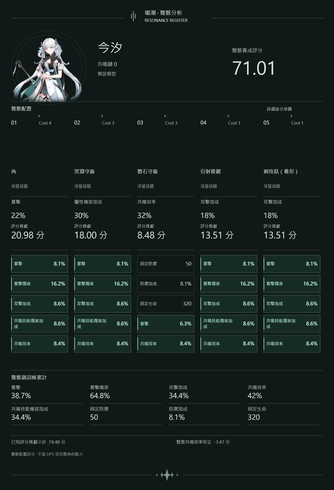
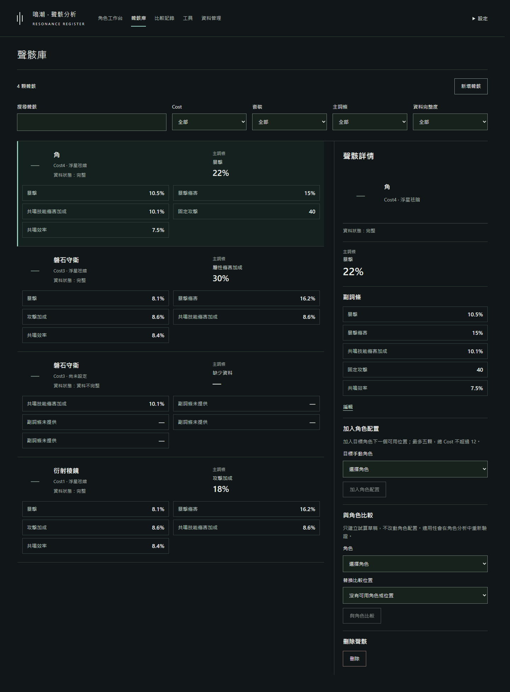
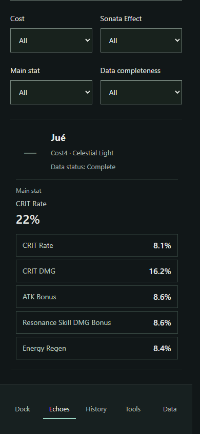
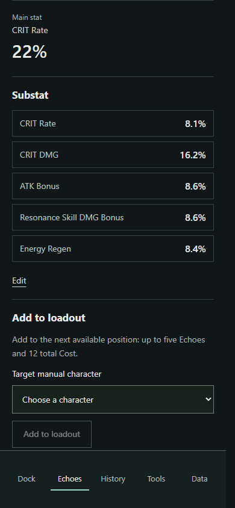

# Register UI 閱讀性驗收

完成日期：2026-10-11。未部署。

本次訊息未附可讀取的兩張截圖，因此以修改前專案實際渲染為基準。所有瀏覽器測試使用隔離 context 與合成存檔，沒有操作使用者瀏覽器資料。

## 詳細分享圖比較

| 項目 | 修改前 | 修改後 |
| --- | --- | --- |
| 範例尺寸 | 1440 × 1830 | 1440 × 2113，依換行與屬性數量自動加高 |
| 副詞條 | 16px 名稱、19px 數值，固定 49px 間距 | 18px 名稱、21px 數值，每列至少 76px、列間 10px |
| 有效性 | 中性文字 | 既有 rawContribution > 0、模型可用且詞條有效時使用 mint 邊框、標記與粗體數值 |
| 缺少資料 | 固定位置文字 | 保留五個對齊詞條框及破折號；未知模型保持中性 |
| 長名稱 | 固定段落位置 | 五欄共用實際量測高度，不縮小字體 |
| 累計屬性 | 17px 名稱、27px 數值 | 20px 名稱、30px 數值，分隔線及自動行高 |

修改前：

修改後（實際下載 PNG）：

預覽 canvas 與實際下載 PNG 逐位元組一致。簡略版修改前／後 PNG 亦逐位元組一致，尺寸皆為 1440 × 1150。

其他樣本：[簡中](../artifacts/register-readability/detailed-zh-CN.png)、[英文](../artifacts/register-readability/detailed-en.png)、[長名稱／僅裝兩顆／缺詞條](../artifacts/register-readability/detailed-long-partial.png)、[空配置](../artifacts/register-readability/detailed-empty.png)、[未知模型](../artifacts/register-readability/detailed-unknown-model.png)。

## 聲骸庫

桌面維持列表／Inspector 約 2:1；Inspector 最小 320px。列表身份、主詞條、兩欄副詞條摘要分區。Inspector 使用獨立主詞條及逐列副詞條。960px 以下沿用點選後的全寬詳情與返回操作，480px 以下詞條單欄排列。圖片失敗時保留占位，避免名稱移入圖片欄。無角色上下文，一律中性樣式。

[修改前完整畫面](../artifacts/register-readability/library-before.png)

[英文完整畫面／長詞條](../artifacts/register-readability/library-desktop-en.png)、[缺少主詞條與副詞條](../artifacts/register-readability/library-missing-en.png)、[手機完整列表](../artifacts/register-readability/library-list-390-zh-TW.png)、[手機完整 Inspector](../artifacts/register-readability/library-inspector-390-zh-TW.png)。完整頁面截圖中的固定底部導覽停留在擷取時的視窗位置；上方手機近距離截圖提供實際可見畫面。

## 驗證結果

- 20 個 tests/*.test.cjs 全數通過；移除未使用展示函式後補跑相關展示與 final-acceptance 測試通過。
- 三語 zh-TW、zh-CN、en，1440／768／390px 實測無水平溢出，1024px 雙欄亦通過。
- 搜尋、Cost／套裝／主詞條／完整度篩選、選取與返回焦點正常。
- 編輯實際保存詞條值；加入角色實際移動庫存聲骸；比較實際建立草稿並導向角色頁。
- 閱覽、選取、三語切換與分享均未改寫 mcData。
- 五條詞條、少詞條、缺主詞條、長英文詞條、長聲骸名稱、空配置、未滿五槽、未知模型已檢查。
- 分享測試刻意使用「暴擊零贡献、生命正贡献」樣本確認不是硬編碼暴擊／暴傷；缺值、無可用貢獻及無效詞條不高亮。
- 瀏覽器沒有未捕獲 JavaScript 錯誤。

限制：此環境無法載入原有遠端聲骸圖片；驗收 PNG 保留原角色立繪，聲骸圖片區為空，庫存使用破折號占位。未替換 catalog、圖片 URL 或偽造圖片。

## 變更範圍

- js/register-share.js：只調整詳細版 Canvas 排版、細框與既有貢獻的視覺強調。
- js/register-secondary-views.js：共用中性詞條展示片段、庫存列表與 Inspector 結構。
- css/register-workspace.css：Register 庫存版面、數值對齊、圖片占位與響應式樣式。
- js/register-workspace.js：移除不再使用的舊連續文字 echoSummary 與其注入參數；事件與寫入流程未改。
- tests/register-share.test.cjs、tests/register-secondary-views.test.cjs：調整動態尺寸驗證，補上有效詞條来源與五列缺值展示驗證。
- artifacts/register-readability/：修改前來源快照、實際 PNG／截圖、qa.cjs、edge-cases.cjs、results.json。

未涉及 Core、評分公式、權重模型、mcData schema、角色／聲骸資料、catalog、圖片來源、匯入、備份、配置及比較邏輯。Classic 未改。沿用原三語字典與格式化方式。

重現：在專案根目錄啟動 `node artifacts/register-share/server.cjs`（已有 8765 服務則不用重啟），執行 `node artifacts/register-readability/qa.cjs`、`node artifacts/register-readability/edge-cases.cjs`。使用現有 bundled Playwright 與 Edge。
